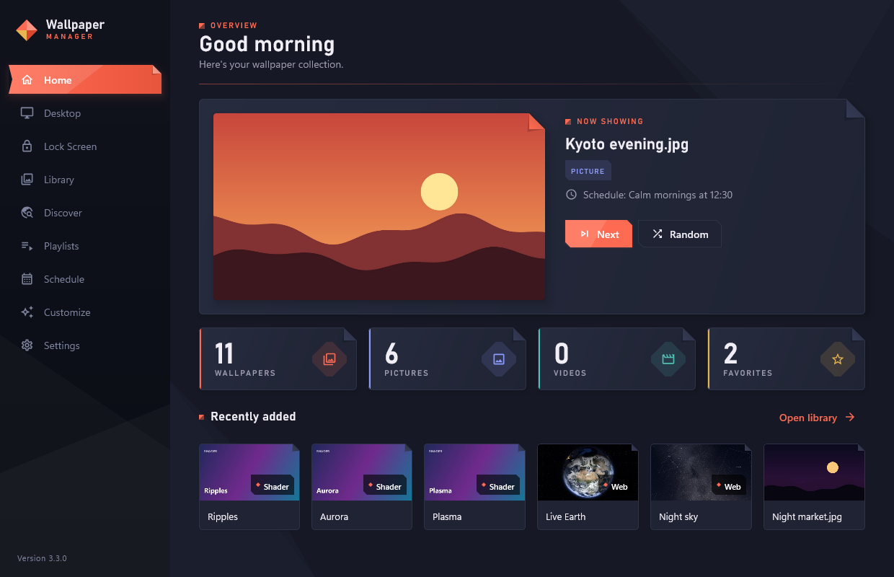
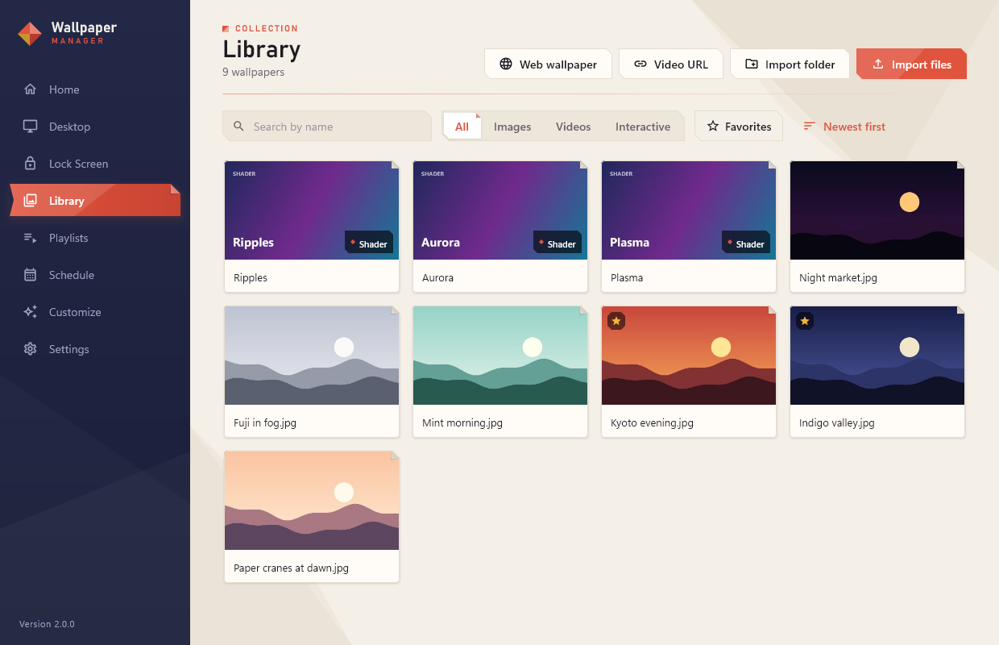
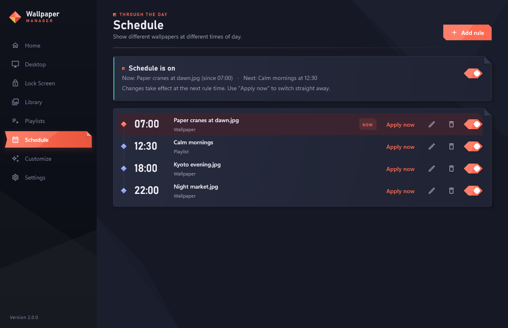
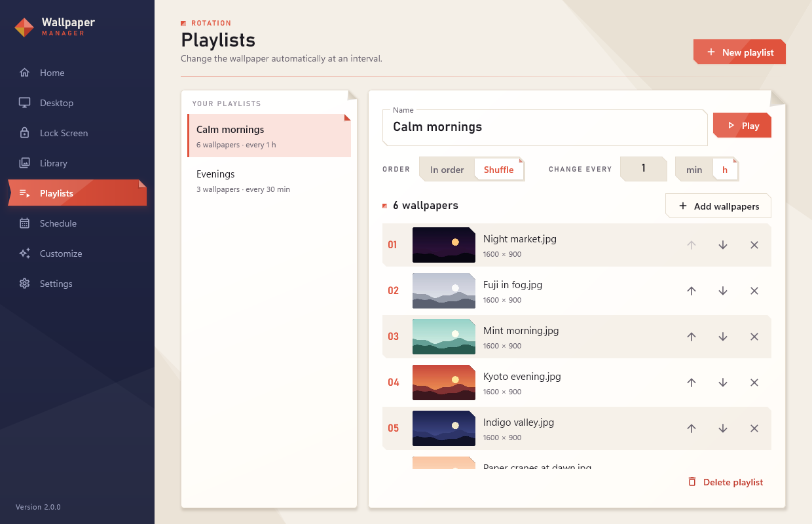

# Wallpaper Manager

A Windows 10/11 app for your desktop and lock screen: a wallpaper library,
live wallpapers behind the desktop icons (videos, online videos, interactive
web pages and shaders that react to the mouse and to music), lock screen
pictures, playlists and a daily schedule.

Version 2 is written in Kotlin with Compose for Desktop. (Version 1.x was a
Python app; your library, playlists and schedule carry over.)

| | |
| --- | --- |
|  |  |
|  |  |

## Features

- **Library** of JPG, PNG, WEBP, GIF, BMP, MP4, WEBM, MKV and MOV files: import
  files or whole folders, or drag them onto the window. Search, filters
  (images / videos / interactive / favorites), sorting, multi-select with
  Ctrl/Shift-click and bulk actions, details panel with a live video preview.
  Files are never copied or moved. **Tags** (filter by them, or search finds them),
  and **missing files**: when files were moved or deleted, the Library says so and
  finds them again by searching a folder (or one at a time). **Watched folders**:
  new pictures and videos in them are added by themselves, deleted ones removed.
- **Pictures** as the desktop wallpaper with Fill / Fit / Stretch / Center / Tile
  (WEBP/GIF converted automatically). Your original wallpaper is backed up and
  can be restored.
- **Live video wallpapers** behind the desktop icons (libmpv, GPU decoding):
  looping, muted by default, pause / resume / stop, Fill or Fit, optional sound,
  and they come back when the app starts.
- **Videos from the internet**: paste a YouTube, Vimeo, ... link (via
  [yt-dlp](https://github.com/yt-dlp/yt-dlp)) or a plain .mp4/.webm/.m3u8 link.
  Stream it (never more than your screen's resolution) or save it for offline use.
- **Interactive web wallpapers**, like [Lively](https://github.com/rocksdanister/lively):
  a folder with an `index.html`, an `.html` file, a `.zip` (Lively wallpapers
  import as they are) or a website, shown by an embedded Chromium. Clicks,
  moves and the wheel on the empty desktop reach the page; icons keep working.
- **Wallpaper settings**: Lively wallpapers that come with a `LivelyProperties.json`
  get their sliders, colors, checkboxes, dropdowns, text fields and buttons in the
  details panel. Changes reach the running wallpaper straight away and are remembered.
- **Shader wallpapers** (Shadertoy-style GLSL) with the **Customize** editor:
  live preview, compile errors with line numbers, four samples to start from.
  `iMouse` follows the desktop mouse, `iPointer` too without a button, `iChannel0`
  is the audio spectrum. A comment adds a setting with a control and a uniform:
  `// @slider speed 0 2 1 Speed`, `// @color tint #ff8800 Tint`,
  `// @checkbox rain on Rain`, `// @image photo Picture` (`iChannel1`-`3`).
- **Discover**: search wallhaven.cc (safe-for-work pictures, at least your screen's
  resolution if you like) and add a picture to the library - or set it - with one click.
- **Wallpaper Engine**: video and web wallpapers from your Steam workshop
  subscriptions import as they are, settings included (scene wallpapers need
  Wallpaper Engine itself).
- **Make a picture alive**: turn any picture into a live wallpaper with a slow
  Ken Burns zoom, parallax that follows the mouse, rain running down the glass, or
  snowfall - each with its own settings.
- **Audio-reactive wallpapers**: system audio levels (WASAPI loopback, 128
  bands, about 30 times a second) go to web pages through Lively's
  `livelyAudioListener` and to shaders. Nothing is recorded or sent.
- **Several displays**: live wallpapers on every display (or only the main one),
  or a different wallpaper per display.
- **Automatic pausing** while the PC is locked, the screen is off, a game runs
  full screen, maximized windows cover the desktop (per display) or, optionally,
  on battery, while any other app is in front, or while apps you choose are in
  front or running (e.g. `obs64.exe`) - without ever overriding your own pause / resume.
- **Lock screen**: any picture, or a frame picked from a video, or a **slideshow**
  of a playlist (every 15 minutes or more). Uses the official WinRT `LockScreen`
  API; the original (and Spotlight) can be restored.
- **Accent color from the wallpaper** (optional): taskbar, Start and window
  borders take the wallpaper's most striking color; your own color comes back
  when you switch it off.
- **Playlists**: in order or shuffled (everything once before repeating), an
  interval in minutes or hours, kept across restarts.
- **Schedule**: daily rules such as 07:00 → morning.jpg, 18:00 → city.mp4,
  22:00 → a playlist, or following the sun: `sunrise`, `sunset - 30`. Sunrise and
  sunset are worked out on the PC for a city you pick (or coordinates); nothing is
  looked up online. Caught up after a restart; daylight-saving safe.
- **Tray icon** (Next / Random / Pause / Stop / Exit), close to tray, start with
  Windows, one copy at a time, daily update check, a diagnostics zip for bug
  reports, dark / light / system theme, and "reduce motion" (follows Windows'
  animation setting).
- **Backup**: one `.wpmbackup` file with the library, playlists, schedule, settings,
  shaders and thumbnails; restore it on another PC (the files you replace are kept).

**Keyboard shortcuts**: Ctrl+1 … Ctrl+9 switch pages, Ctrl+F searches the
library, Ctrl+I imports files, Ctrl+A / Delete / Esc work on the library selection.

**Global shortcuts** (switch them on in Settings; they work while any app is in front):
Ctrl+Alt+N next wallpaper, Ctrl+Alt+R random, Ctrl+Alt+P pause / resume,
Ctrl+Alt+W open the window. Click a shortcut in Settings to change it.

**Command line**, for scripts, Task Scheduler, AutoHotkey or a Stream Deck. Commands
go to the running copy (it is started first if needed):

```
WallpaperManager.exe --next | --random | --pause | --resume | --toggle-pause | --stop
WallpaperManager.exe --set "C:\Pictures\sunset.jpg"    (a file, added to the library if needed)
WallpaperManager.exe --set "sunset"                    (or a library item by name)
WallpaperManager.exe --playlist "Evenings" | --stop-playlist | --show | --help
```

The exit code is 0 when it worked, 1 when it didn't and 2 for unknown options; the
result is printed when the output is redirected (`WallpaperManager.exe --next | Out-String`).

## Download

Get the installer or the zip from the
[Releases page](https://github.com/adipro1/wallpaper-manager/releases). See
[`packaging/READ ME FIRST.txt`](packaging/READ%20ME%20FIRST.txt) for a short
user guide.

## Building from source

Requirements: Windows 10/11 and JDK 21 (e.g. `winget install Microsoft.OpenJDK.21`).
Gradle comes with the project (`gradlew`).

```powershell
cd desktop
./gradlew getLibmpv getYtDlp   # once: native helpers into ..\bin (pinned, SHA-256 checked)
./gradlew run                  # start the app
./gradlew check                # tests
./gradlew zipDistributable     # ..\dist\WallpaperManager-<version>-win64.zip
./gradlew installer            # ..\dist\WallpaperManager-<version>-setup.exe (needs Inno Setup 6)
```

`WallpaperManager.exe --self-test` checks every engine on a PC (displays,
desktop layer, libmpv, yt-dlp, audio capture, Chromium) and writes the results
to the log - handy for bug reports.

### Tests

The normal test run never changes your wallpaper or lock screen: Windows calls
go through interfaces with fakes, and a UI smoke test opens every page in both
themes. Some tests use the real system and are opt-in:

| Variable | What it enables |
| --- | --- |
| `WPM_DESKTOP_TEST=1` | Plays a video, a web page and a shader behind your desktop icons for a few seconds, compiles the sample shaders, captures system audio, reads the display list |
| `WPM_NETWORK_TEST=1` | Looks up and streams a YouTube video through yt-dlp and mpv |

### Developing next to an installed copy

Only one copy runs at a time. Set `WPM_INSTANCE=dev` to run a development build
next to the installed app, and `WPM_DATA_DIR` to use a separate data folder.

## How live wallpapers work

Explorer draws the desktop in two layers: a `WorkerW` window that paints the
wallpaper and, above it, the window holding the icons (`SHELLDLL_DefView`).
The app sends Explorer's `Progman` window the undocumented message `0x052C` to
create that split and puts its windows into the wallpaper layer, so they appear
above the wallpaper and below the icons (`win32/DesktopLayer.kt`). On Windows 11
24H2 both layers live inside `Progman`, which is handled too.

- Videos: libmpv draws into a window the app creates there (`engine/LivePlayer.kt`).
- Web pages and shaders: Chromium (JCEF) creates its own window, which is moved
  into the layer (`engine/WebEngine.kt`). Chromium is downloaded the first time
  a web wallpaper is used (about 150 MB).
- Mouse interaction: the icon window gets all mouse input, so a low-level mouse
  hook copies moves, clicks and the wheel over the empty desktop to Chromium's
  input window (`engine/InputForwarder.kt`).
- If Explorer restarts, the watchdog recreates the windows within a few seconds.
- Other live wallpaper apps (Lively, Wallpaper Engine) use the same layer; the
  Desktop page warns if one may cover the wallpaper.

## Where data is stored

Everything the app generates lives in `%LOCALAPPDATA%\WallpaperManager` (or
`WPM_DATA_DIR`):

| Path | Contents |
| --- | --- |
| `library.db` | SQLite database: settings and library metadata (`library.v3.bak.db`: copy from before the 2.0 upgrade) |
| `thumbnails\` | Thumbnails |
| `backup\` | Your wallpaper and lock screen from before the first change |
| `cache\` | Converted pictures, shader pages, video frames |
| `lockscreen\` | Lock screen pictures and frames |
| `web\`, `shaders\` | Unpacked web wallpapers (.zip) and shader code |
| `chromium\` | The web engine, downloaded on first use |
| `logs\` | Log files (rotating) |

Offline copies of online videos are saved to `Videos\Wallpapers`.

## Project layout

```
desktop/                        Kotlin + Compose app (Gradle)
  src/main/kotlin/wpm/
    Main.kt, AppState.kt        Entry point, single instance, app-wide state
    SelfTest.kt                 --self-test
    data/                       SQLite database, migrations, settings
    media/                      Imaging (Skia), import, thumbnails, yt-dlp, web wallpapers, shaders
    mpv/                        libmpv binding, video probing and frames
    engine/                     Live wallpaper engines: video, web, routing, displays, mouse, audio
    services/                   Wallpapers, lock screen, playlists, schedule, automation, updates, diagnostics
    win32/                      Windows APIs (JNA): desktop layer, displays, system state, COM
    ui/                         Theme, components and one file per page
  src/main/resources/           Icon, lock screen script, shader runner and samples
  src/test/kotlin/              Tests
packaging/                      Inno Setup script and the end-user readme
bin/                            libmpv-2.dll and yt-dlp.exe (downloaded, not in Git)
```
