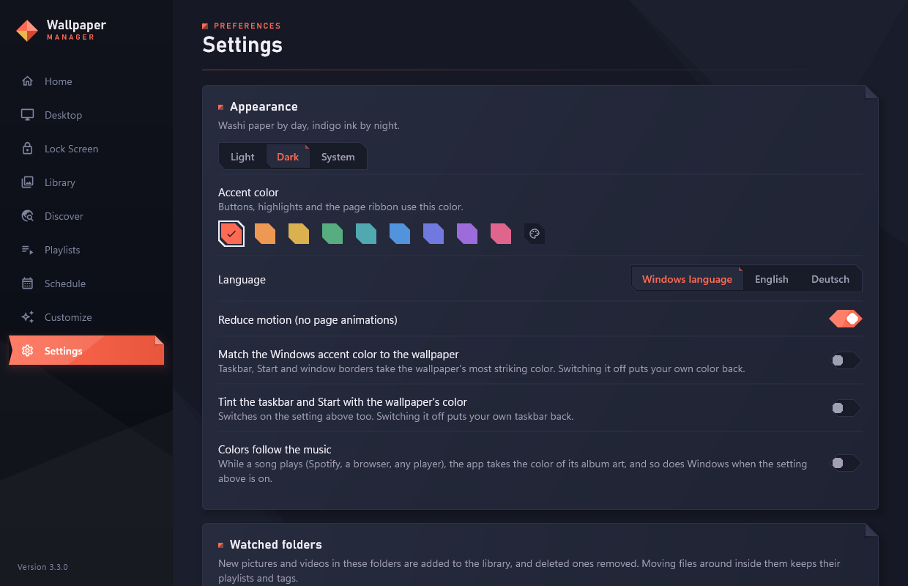
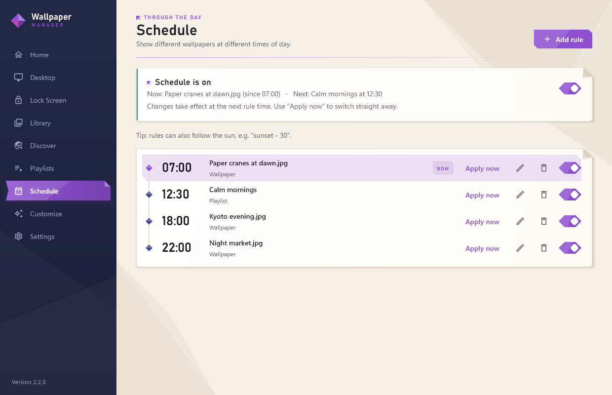
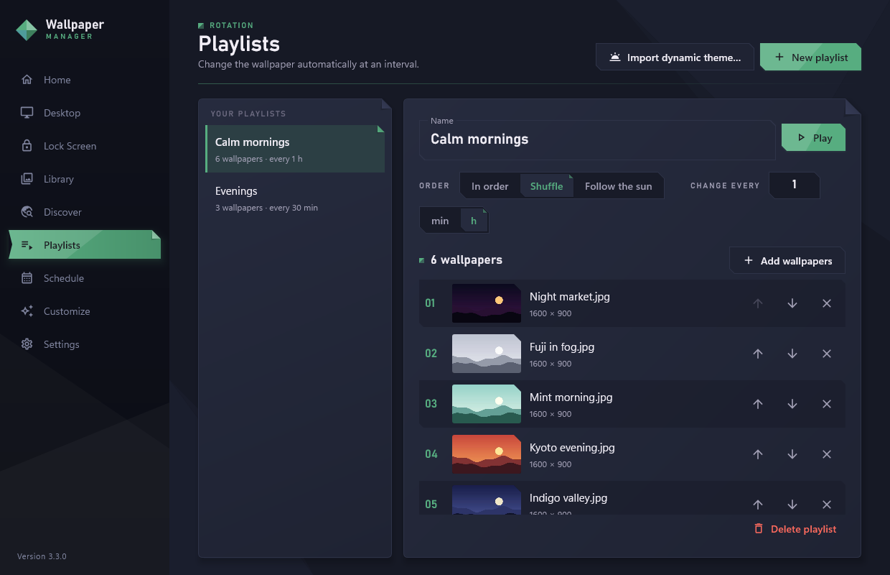
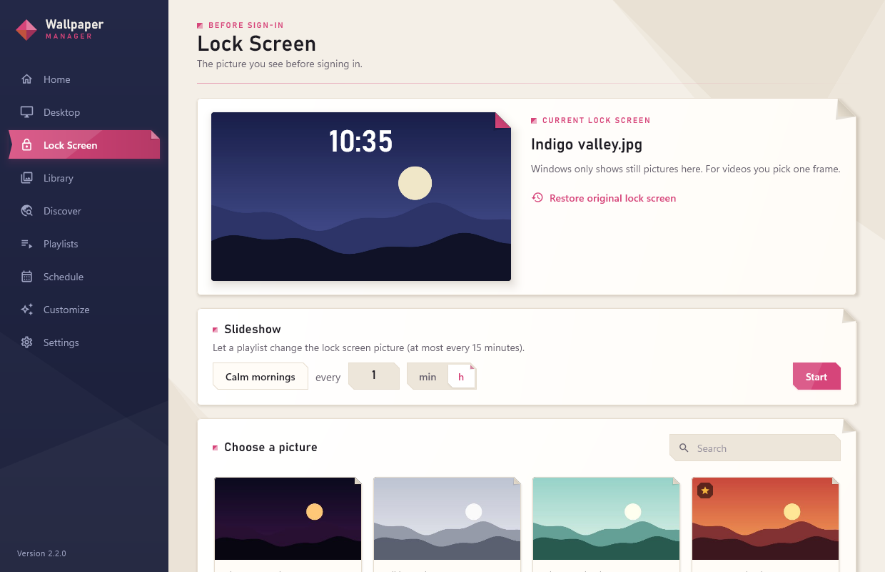

# Wallpaper Manager

A Windows 10/11 app for your desktop and lock screen: a wallpaper library, live
wallpapers behind the desktop icons (videos, online videos, interactive web pages
and shaders that react to the mouse and to music), lock screen pictures and
slideshows, playlists and a schedule that follows the clock or the sun.

**[Download the latest version](https://github.com/adipro1/wallpaper-manager/releases/latest)**:
the installer (`WallpaperManager-<version>-setup.exe`, no administrator rights
needed) or the zip. Once installed, the app updates itself with one click.

| | |
| --- | --- |
|  |  |
|  |  |
|  |  |

## What's new in 3.1 "Depth & Music"

- **3D photos**: AI works out what is near and far in a photo, so it moves like a real 3D scene
  with the mouse.
- **Layers**: 3D motion, fireflies, light rays, fog, real rain and snow and music bars on one picture.
- **Now Playing**: wallpapers know what Spotify, your browser or any player is playing; the
  picture and the app's colors can follow the album art.

3.0 "Alive" brought day and night, Living weather, picture transitions and dynamic themes.
All changes are in the [release notes](https://github.com/adipro1/wallpaper-manager/releases).

## Features

### Wallpapers
- **Pictures** (JPG, PNG, WEBP, GIF, BMP) with Fill / Fit / Stretch / Center / Tile.
  Your original wallpaper is backed up and can be restored.
- **Live video wallpapers** (MP4, WEBM, MKV, MOV) behind the desktop icons, played by
  libmpv with GPU decoding: looping, muted unless you want sound, Fill or Fit.
- **Videos from the internet**: paste a YouTube, Vimeo, ... link (through
  [yt-dlp](https://github.com/yt-dlp/yt-dlp)) or a plain .mp4/.webm/.m3u8 link.
  Stream it (never above your screen's resolution) or save it for offline use.
- **Interactive web wallpapers**, like [Lively](https://github.com/rocksdanister/lively):
  a folder with an `index.html`, an `.html` file, a `.zip` (Lively wallpapers import
  as they are) or a website, shown by an embedded Chromium. Clicks, moves and the
  wheel on the empty desktop reach the page; your icons keep working.
- **Wallpaper settings**: Lively wallpapers with a `LivelyProperties.json` get their
  sliders, colors, switches, dropdowns and buttons in the Library. Changes reach the
  running wallpaper straight away.
- **Shader wallpapers** (Shadertoy-style GLSL) made in the **Customize** editor, with
  a live preview, compile errors with line numbers and samples to start from.
  `iMouse` follows the desktop mouse, `iChannel0` is the audio spectrum, and `iSun`,
  `iWeather` and `iClouds` are the real sky (the sun's height and direction, rain / snow /
  fog / storm, cloud cover), `iMusic` the album art's color while music plays. Comments
  add settings: `// @slider speed 0 2 1 Speed`, `// @color tint #ff8800 Tint`,
  `// @checkbox rain on Rain`, `// @image photo Picture` (`iChannel1`-`3`),
  `// @depth depth photo` (the picture's AI depth map, white = near).
- **Make a picture alive**: a 3D photo, layers of effects, day and night that follow the real
  sun, the real weather (rain, snow, fog, storms), colors that follow the music, a slow Ken
  Burns zoom, parallax that follows the mouse, rain on the glass or snowfall, for any picture.
- **3D photos**: AI works out what is near and far in a photo, so it moves like a real 3D
  scene with the mouse and a slow camera drift. The model ([Depth Anything V2 Small](https://huggingface.co/depth-anything/Depth-Anything-V2-Small),
  Apache-2.0, 27 MB) is downloaded the first time and runs on your PC with ONNX Runtime.
- **Layers**: stack effects on one picture and switch each on in its settings: 3D motion,
  fireflies that fly behind nearer branches, light rays, fog in the distance, the real rain
  and snow, music bars and a soft light at the mouse.
- **Now Playing**: what Spotify, a browser or any player in Windows' media flyout plays reaches
  web wallpapers (Lively's `livelyCurrentTrack`) and shaders (`iMusic`). "Colors follow the
  music" gives the app (and, if you like, Windows) the album art's color while a song plays.
- **Transitions**: when the picture changes it folds away like paper, fades, burns away or
  ripples (Settings > Live wallpapers > Picture changes).
- **Audio-reactive**: what your PC plays (WASAPI loopback, 128 bands, about 30 times
  a second) reaches web pages through Lively's `livelyAudioListener` and shaders.
  Nothing is recorded or sent.
- **Several displays**: live wallpapers on every display or only the main one, or a
  different wallpaper per display.
- **Desktop widgets** (Desktop > Widgets): a clock, the weather, the song that plays, CPU /
  memory / GPU use and a calendar behind the icons, over any wallpaper (picture, video or
  web page). Drag them into place on a picture of your screen; size and a dark card are
  optional.

### Finding and organizing
- **Library**: import files or folders, or drag them (or links) onto the window.
  Files are never copied or moved. Search, filters, sorting, favorites, **tags**,
  multi-select with Ctrl/Shift-click and bulk actions.
- **Discover**: search [wallhaven.cc](https://wallhaven.cc) (safe-for-work pictures,
  at least your screen's resolution if you like) and add or set a picture with one click.
- **Wallpaper Engine**: video and web wallpapers from your Steam workshop
  subscriptions import with their settings (scene wallpapers need Wallpaper Engine itself).
- **Watched folders**: new pictures and videos in them are added by themselves,
  deleted ones removed.
- **Missing files**: when files were moved, the Library says so and finds them again.

### Changing by itself
- **Playlists**: in order or shuffled (everything once before repeating), every few
  minutes or hours, or **following the sun** (some pictures for the day, the others for
  the night), kept across restarts. **Dynamic themes**: WinDynamicDesktop `.ddw` themes
  import as such a playlist.
- **Schedule**: daily rules such as 07:00 → morning.jpg, 22:00 → a playlist, or
  following the sun: `sunrise`, `sunset - 30`. Sunrise and sunset are worked out on
  the PC for a city you pick; nothing is looked up online. Daylight-saving safe.
- **Automatic pausing** while the PC is locked, the screen is off, a game runs full
  screen, windows cover the desktop or (optionally) on battery, while any other app
  is in front, or while apps you choose run (e.g. `obs64.exe`). Your own pause and
  resume always win.
- **Lock screen**: any picture, a frame from a video, or a **slideshow** from a
  playlist. Uses Windows' official `LockScreen` API; the original (and Spotlight)
  can be restored.

### Making it yours
- **Light, dark or system** mode, and an **accent color** of your choice.
- **Accent color from the wallpaper** (optional): taskbar, Start and window borders
  take the wallpaper's most striking color; yours comes back when you switch it off.
- **Languages**: English and German (Settings > Appearance > Language).
- **Accessible**: visible keyboard focus, screen reader labels and states, and
  "reduce motion" (follows Windows' animation setting).

### Everyday
- **Tray icon** with Next / Random / Pause / Stop / Exit, close to tray, start with
  Windows.
- **One-click updates**: when a new version is out, "Install now" downloads it from
  GitHub (size and SHA-256 checked), installs it and restarts.
- **Backup**: one `.wpmbackup` file with the library, playlists, schedule, settings,
  shaders and thumbnails, to restore on another PC.
- **Performance** panel with the CPU, memory and GPU the app uses, and frame rate
  caps for shaders and web wallpapers.
- **Diagnostics**: Settings > "Save diagnostics..." makes a zip with the logs for bug reports.

## Shortcuts and command line

**In the app**: Ctrl+1 … Ctrl+9 switch pages, Ctrl+F searches the library, Ctrl+I
imports files, Ctrl+A / Delete / Esc work on the library selection.

**Global shortcuts** (switch them on in Settings; they work in any app):
Ctrl+Alt+N next wallpaper, Ctrl+Alt+R random, Ctrl+Alt+P pause / resume,
Ctrl+Alt+W open the window. Click a shortcut in Settings to change it.

**Command line**, for scripts, Task Scheduler, AutoHotkey or a Stream Deck. Commands
go to the running copy (which is started first if needed):

```
WallpaperManager.exe --next | --random | --pause | --resume | --toggle-pause | --stop
WallpaperManager.exe --set "C:\Pictures\sunset.jpg"    (a file, added to the library if needed)
WallpaperManager.exe --set "sunset"                    (or a library item by name)
WallpaperManager.exe --playlist "Evenings" | --stop-playlist | --update | --show | --help
```

The exit code is 0 when it worked, 1 when it didn't and 2 for unknown options; the
result is printed when the output is redirected (`WallpaperManager.exe --next | Out-String`).

## Installing

- **Installer**: run `WallpaperManager-<version>-setup.exe`. Installing over an older
  version (including the old Python 1.x app) keeps your library, playlists, schedule
  and settings.
- **Zip**: unzip the whole folder somewhere permanent and run `WallpaperManager.exe`.
- The app isn't code-signed, so Windows may say "Windows protected your PC": click
  "More info", then "Run anyway".

[`packaging/READ ME FIRST.txt`](packaging/READ%20ME%20FIRST.txt) is the short user
guide that comes with the app.

## Building from source

Requirements: Windows 10/11 and JDK 21 (e.g. `winget install Microsoft.OpenJDK.21`).
Gradle comes with the project (`gradlew`). The app is written in Kotlin with
Compose for Desktop.

```powershell
cd desktop
./gradlew getLibmpv getYtDlp   # once: native helpers into ..\bin (pinned, SHA-256 checked)
./gradlew run                  # start the app
./gradlew check                # tests
./gradlew zipDistributable     # ..\dist\WallpaperManager-<version>-win64.zip
./gradlew installer            # ..\dist\WallpaperManager-<version>-setup.exe (needs Inno Setup 6)
```

`WallpaperManager.exe --self-test` checks every engine on a PC (displays, desktop
layer, libmpv, yt-dlp, audio capture, Chromium) and writes the results to the log.

### Releasing

Bump `appVersion` in `desktop/build.gradle.kts`, add `docs/release-notes-<version>.md`
and push a `v<version>` tag. GitHub Actions tests and builds the installer and zip and
publishes the release; installed copies then offer the update.

### Tests

The normal test run never changes your wallpaper or lock screen: Windows calls go
through interfaces with fakes, and UI tests open every page in both themes. Some
tests use the real system and are opt-in (run them with `./gradlew test --rerun`):

| Variable | What it enables |
| --- | --- |
| `WPM_DESKTOP_TEST=1` | Plays a video, a web page and a shader behind your desktop icons for a few seconds, compiles the sample shaders, captures system audio, reads the display list, colors a real window's title bar |
| `WPM_NETWORK_TEST=1` | Streams a YouTube video through yt-dlp and mpv, downloads a real release for the updater, downloads the depth model and makes a depth map |

### Developing next to an installed copy

Only one copy runs at a time. Set `WPM_INSTANCE=dev` to run a development build next
to the installed app, and `WPM_DATA_DIR` to use a separate data folder.

## How live wallpapers work

Explorer draws the desktop in two layers: a `WorkerW` window that paints the
wallpaper and, above it, the window holding the icons (`SHELLDLL_DefView`). The app
sends Explorer's `Progman` window the undocumented message `0x052C` to create that
split and puts its windows into the wallpaper layer, so they appear above the
wallpaper and below the icons (`win32/DesktopLayer.kt`). On Windows 11 24H2 both
layers live inside `Progman`, which is handled too.

- Videos: libmpv draws into a window the app creates there (`engine/LivePlayer.kt`).
- Web pages and shaders: Chromium (JCEF) creates its own window, which is moved into
  the layer (`engine/WebEngine.kt`). Chromium is downloaded the first time a web
  wallpaper is used (about 150 MB).
- Mouse: the icon window gets all mouse input, so a low-level mouse hook copies
  moves, clicks and the wheel over the empty desktop to Chromium (`engine/InputForwarder.kt`).
- If Explorer restarts, a watchdog recreates the windows within a few seconds.
- Other live wallpaper apps (Lively, Wallpaper Engine) use the same layer; the
  Desktop page warns if one may cover the wallpaper.

## Where data is stored

Everything the app generates lives in `%LOCALAPPDATA%\WallpaperManager` (or
`WPM_DATA_DIR`):

| Path | Contents |
| --- | --- |
| `library.db` | SQLite database: settings and library (`library.v3.bak.db`, `library.v4.bak.db`: copies from before upgrades) |
| `thumbnails\` | Thumbnails |
| `backup\` | Your wallpaper and lock screen from before the first change |
| `cache\` | Converted pictures, shader pages, video frames, downloaded updates |
| `lockscreen\` | Lock screen pictures and frames |
| `web\`, `shaders\` | Unpacked web wallpapers (.zip) and shader code |
| `chromium\` | The web engine, downloaded on first use |
| `logs\` | Log files (rotating) |

Offline copies of online videos go to `Videos\Wallpapers`, pictures from Discover to
`Pictures\Wallpapers`.

## Project layout

```
desktop/                        Kotlin + Compose app (Gradle)
  src/main/kotlin/wpm/
    Main.kt, AppState.kt        Entry point, single instance, app-wide state
    Commands.kt, I18n.kt        Command line, translations
    SelfTest.kt                 --self-test
    data/                       SQLite database, migrations, settings
    media/                      Imaging, import, thumbnails, yt-dlp, web wallpapers, shaders,
                                wallhaven, Wallpaper Engine, wallpaper settings
    mpv/                        libmpv binding, video probing and frames
    engine/                     Live wallpaper engines: video, web, routing, displays, mouse, audio
    services/                   Wallpapers, lock screen, playlists, schedule, sun, automation,
                                watched folders, accent color, backup, updates
    win32/                      Windows APIs (JNA): desktop layer, displays, system state,
                                hotkeys, command pipe, title bar, COM
    ui/                         Theme, components and one file per page
  src/main/resources/           Icon, translations, lock screen script, shader runner, effects and samples
  src/test/kotlin/              Tests
packaging/                      Inno Setup script and the end-user readme
docs/                           Release notes and screenshots
bin/                            libmpv-2.dll and yt-dlp.exe (downloaded, not in Git)
```
